# Rally de la Independencia AR

Juego de búsqueda con **realidad aumentada** en Dolores Hidalgo, Guanajuato.
Seis personajes de la Independencia se esconden al azar y hay que encontrarlos con un radar,
el "frío o caliente" y la cámara.
Desarrollo Móvil Integral · UTNG

## Diseño del juego

| Pregunta | Respuesta |
|---|---|
| Objetivo | Atrapar a los 6 personajes de la Independencia |
| ¿Cómo se encuentra uno? | Con el radar, el "frío o caliente" y la vista en RA |
| ¿Cuándo se puede atrapar? | A 15 metros o menos |
| ¿Cómo se atrapa? | Respondiendo bien una pregunta de historia |
| ¿Qué pasa si fallas? | 2 intentos; con 2 fallos el personaje huye y reaparece en otro lugar |
| Puntuación | 100 puntos al primer intento, 50 al segundo |
| ¿Cómo se gana? | Atrapando a los 6; el progreso se guarda en el álbum |
| Distancia de los personajes | Entre 60 y 500 m del Jardín Principal |

### Escala de temperatura (frío o caliente)

| Distancia | Temperatura |
|---|---|
| 15 m o menos | 🌋 Ardiente |
| Hasta 50 m | 🔥 Caliente |
| Hasta 150 m | 🙂 Tibio |
| Hasta 400 m | ❄️ Frío |
| Más lejos | 🥶 Helado |

## Matemáticas aplicadas

- Distancia entre coordenadas: **Haversine**.
- Rumbo entre dos puntos con `atan2`.
- **`destino`**: coordenada a la que llegas al caminar N metros con un rumbo (se prueba en 9 direcciones, de ida y vuelta).
- Diferencia angular por el camino corto (resuelve el salto 359° → 1°) y suavizado circular de la brújula.
- Campo de visión de 60°: convierte el ángulo en posición horizontal de pantalla.
- **Radar:** coordenadas polares a cartesianas (`x = f·sen(a)`, `y = −f·cos(a)`).
- **Azar uniforme por área:** se usa raíz cuadrada para que los personajes no se amontonen cerca del centro.

## Pruebas

En cada ronda se escribe primero la prueba, se ve fallar (rojo), se implementa lo mínimo para que pase (verde) y después se mejora el código.

### Ronda 1: Geo (distancia, rumbo y destino)
**Rojo:** la prueba falla porque aún no existe `geo.dart`.

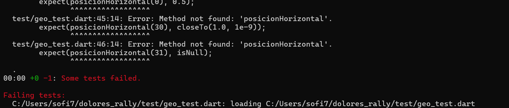

**Verde:** con `geo.dart` implementado, la prueba pasa.

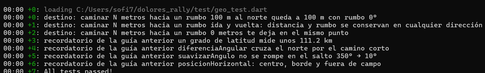

### Ronda 2: Personajes, catálogo y apariciones
**Rojo:**

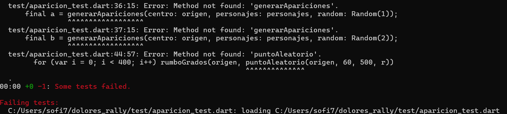

**Verde:**

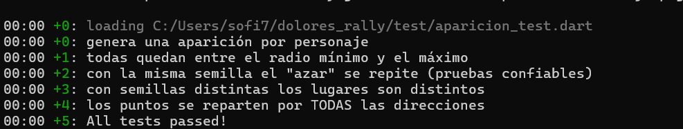

### Ronda 3: Radar y frío o caliente
**Rojo:**

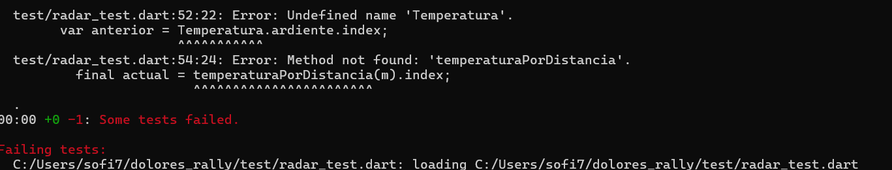

**Verde:**

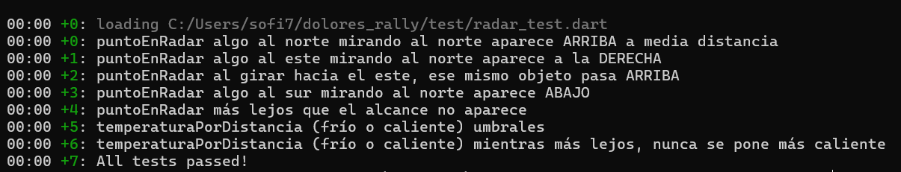

### Ronda 4: Motor de RA
**Rojo:**

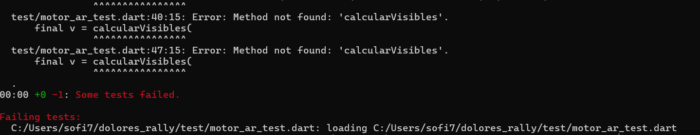

**Verde:**

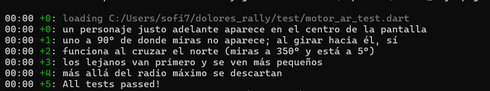

### Ronda 5: Partida (reglas, excepciones y álbum)
**Rojo:**

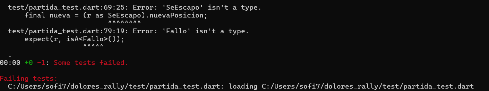

**Verde:**

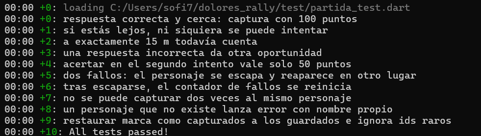

### Ronda 6: RallyViewModel
**Rojo:**

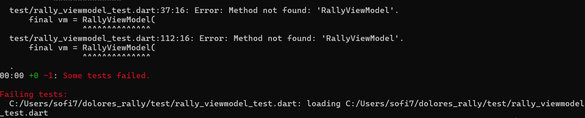

**Verde:**

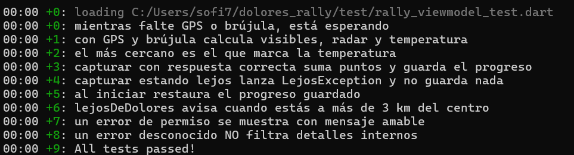

### Resultado final: todas las pruebas pasando
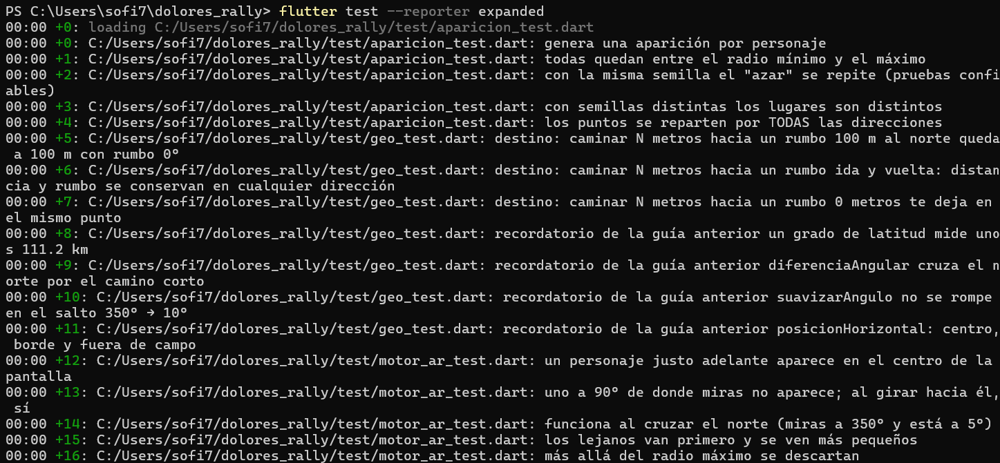
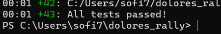

Cubren geometría (incluida `destino`), azar con semilla, radar y temperatura, motor de RA, reglas de la `Partida` y el `RallyViewModel`.

## Evidencias

### Funcionamiento App
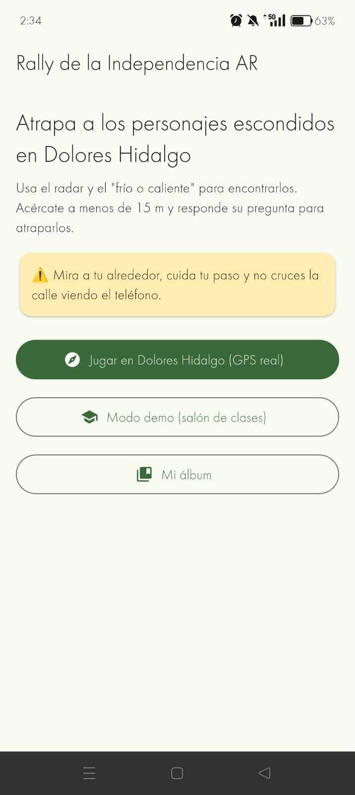
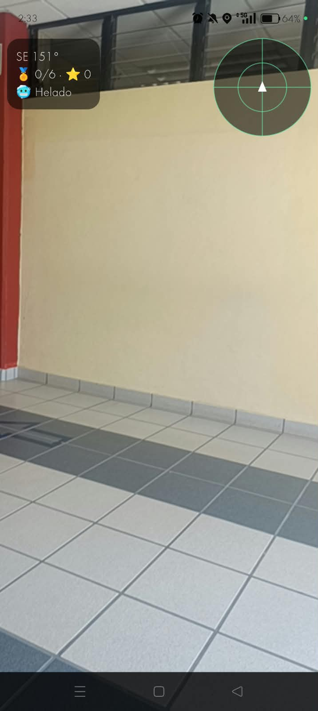
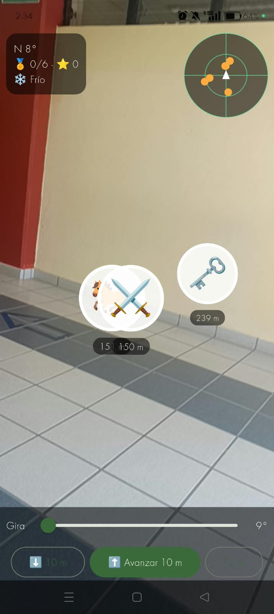
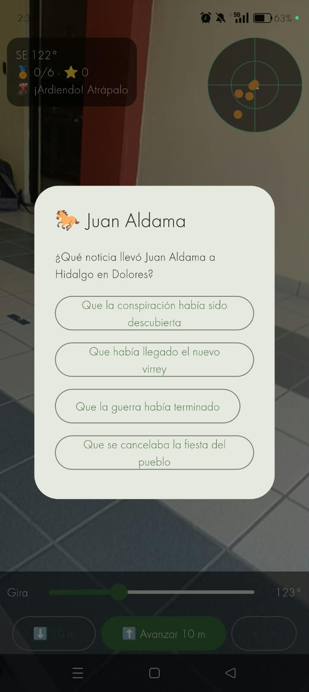
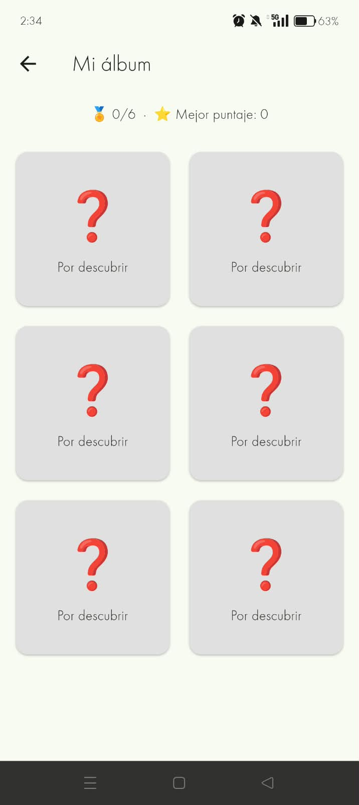
